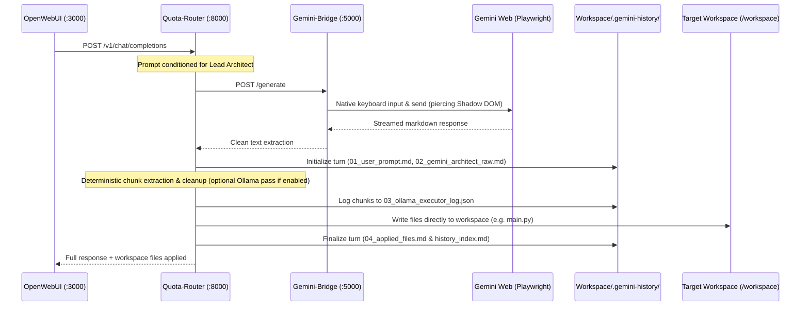

# ZeroGravity (`0g`)

[](https://github.com/YHDF/ZeroGravity/actions/workflows/ci.yml)
[](https://github.com/YHDF/ZeroGravity/actions/workflows/codeql.yml)

> **Zero-Token Autonomous Code Generation Pipeline** bridging Headless Gemini Web with Direct Workspace Patching.

ZeroGravity (`0g`) turns Google's free Gemini Web interface into a high-capacity, autonomous code generation backend. Gemini acts as the **Lead Architect**, and a deterministic extraction pipeline turns its answer into clean source files written directly to your workspace.

> [!NOTE]
> **The local AI module (Ollama) is disabled by default.** Code blocks returned by Gemini are cleaned by a deterministic parser and written as-is — no local model, no GPU, no extra container. The Ollama stage is still available as an opt-in (see [Optional: Local AI Module](#-optional-local-ai-module-ollama)).

---

## 🏛️ Architecture



### 1. Gemini Web: The Lead Architect
* Prompted with explicit awareness that its code blocks are parsed automatically and written straight to disk.
* Outputs high-level architectural designs, full file implementations, and shell execution commands.

### 2. Deterministic Extractor (default)
* Splits Gemini's answer into per-file chunks using `File: <path>` markers and fenced code blocks.
* Strips web-scraping artifacts, language tags, and conversational preambles.
* Validates paths, syntax, and commands before anything touches disk.

### 3. OpenWebUI Internal Interceptor
* Filters out OpenWebUI's automatic background meta-prompts (tag generation, follow-up suggestions, chat titles) and answers them in `<1ms`, preventing background tasks from triggering generation or modifying workspace files.

### 4. Polyglot Language & Framework Support
ZeroGravity natively parses, validates, and routes multi-language projects:
* **Java & Spring Boot**: Automatic package-to-path resolution (`package com.example.demo...` automatically maps to `src/main/java/com/example/demo/<Class>.java` and `src/test/java/...` for `@Test` classes), Maven `pom.xml`, Gradle `build.gradle`, Spring annotations preservation (`@RestController`, `@Service`, `@Entity`, etc.).
* **TypeScript & JavaScript**: Full support for Node.js, Express, React, Next.js, and Vite projects (`package.json`, `tsconfig.json`, `*.ts`, `*.tsx`, `*.js`, `*.jsx`), ES modules, and Jest/Vitest runners.
* **Configuration & Data Formats**: Native syntax validation for `application.yaml` (PyYAML), `package.json` (JSON parser), and `pom.xml` (XML ElementTree), passing data files directly without unwanted code wrappers.
* **Python**: Full support for FastAPI, Flask, Django, Pytest, and CLI scripts with AST syntax validation.

---

## 📂 Audit Telemetry & History (`.gemini-history/`)

Every interaction is archived in `target-app/.gemini-history/` for complete auditability:

```text
.gemini-history/
├── history_index.md             <-- Human-readable overview table of all turns
├── history_index.json           <-- Machine-readable JSON telemetry array
└── turns/
    └── turn_001_20260913_184145/
        ├── 01_user_prompt.md            <-- Exact user prompt from OpenWebUI
        ├── 02_gemini_architect_raw.md   <-- Raw clean text from Gemini Web
        ├── 03_ollama_executor_log.json  <-- Per-chunk input/output (status "direct_text" when local AI is off)
        └── 04_applied_files.md          <-- Summary of created/updated files on disk
```

> [!NOTE]
> The `03_ollama_executor_log.json` filename and "Ollama Chunks" column are kept for backwards compatibility; with the local AI module disabled they record the deterministic cleanup of each chunk.

### Telemetry Index Table Example (`history_index.md`):

| Turn | Timestamp | Prompt Summary | Raw Chars | Ollama Chunks | Files Written | Details |
| :--- | :--- | :--- | :--- | :--- | :--- | :--- |
| `turn_001_20260913_184145` | 20260913_184145 | _Create a file main.py with a Python script..._ | 491 | 1 | `main.py` | [View Turn](turns/turn_001_20260913_184145/) |

---

## 🚀 Quickstart

### 1. Prerequisites
* [Docker Desktop](https://www.docker.com/) with Docker Compose.
* Google account pre-authenticated in `~/.zerogravity-profile` (see step 4).

### 2. Environment Setup
Copy the example environment file:
```bash
cp .env.example .env
```

Configure your target workspace path in `.env`:
```env
WORKSPACE_PATH=../target-app
ZEROGRAVITY_HEADLESS=true
ZEROGRAVITY_LOCAL_AI=false
```

### 3. Start the Stack
```bash
docker compose up -d
```

Services started:
* **`gemini-bridge`**: Headless Playwright browser automation on port `5000` (bundled Chromium).
* **`quota-router`**: FastAPI router & extraction engine on port `8000`.
* **`open-webui`**: Web chat interface on `http://localhost:3000`.

The `ollama` service is **not** started by default (it lives in the `local-ai` compose profile).

### 4. Authenticate Gemini Web with Your Google Account (One-time, Dockerized)
No local Python or Playwright installation is needed on your host machine. Both `run_local.ps1` (PowerShell) and `run_local.sh` (Bash) run the bridge inside Docker and expose an interactive **noVNC web viewer** on `http://localhost:6080` when `-Headed` / `--headed` is passed:

**PowerShell (Windows):**
```powershell
# 1. Launch headed login container (opens http://localhost:6080/vnc.html?autoconnect=true&resize=scale)
.\services\browser_bridge\run_local.ps1 -Headed

# Or use a dedicated profile folder for a specific Google account:
.\services\browser_bridge\run_local.ps1 -ProfileDir "$HOME\.zg-work" -Headed
```

**Bash (Linux / macOS / Git Bash / WSL):**
```bash
# 1. Launch headed login container (opens http://localhost:6080/vnc.html?autoconnect=true&resize=scale)
./services/browser_bridge/run_local.sh --headed

# Or use a dedicated profile folder for a specific Google account:
./services/browser_bridge/run_local.sh --profile-dir "$HOME/.zg-work" --headed
```

1. In the browser tab that opens (`http://localhost:6080/vnc.html?autoconnect=true&resize=scale`), click **Sign in** inside the container's Chromium window and log in to your Google account.
2. Once signed in and the Gemini prompt box is visible, press **`Ctrl+C`** in your terminal.
3. Now run in **headless mode** (without `-Headed` / `--headed`, or via `docker compose up -d`) — the container reuses the exact same Linux Chromium profile (`--password-store=basic`) and stays logged into your Google account:
   ```powershell
   # PowerShell (headless):
   .\services\browser_bridge\run_local.ps1 -ProfileDir "$HOME\.zg-work"
   ```
   ```bash
   # Bash (headless):
   ./services/browser_bridge/run_local.sh --profile-dir "$HOME/.zg-work"
   ```

---

## 🦁 Optional: Native Host Browser Mode (`-Native` / `--native`)

If you have Python installed on the host and specifically want to drive a host-installed browser binary (Brave / Chrome / Edge) outside Docker, pass `-Native` / `--native` or `-BrowserExecutable` / `-Channel`:

```powershell
# 1. Start the bridge natively on the host (requires local Python 3.11+)
cd services\browser_bridge
.\run_local.ps1 -Native -BrowserExecutable "C:\Program Files\BraveSoftware\Brave-Browser\Application\brave.exe" -Headed
#   or: .\run_local.ps1 -Native -Channel chrome
#   or: .\run_local.ps1 -Native -Channel msedge
```

```env
# 2. In .env, point the router at the host bridge
ZEROGRAVITY_BROWSER_URL=http://host.docker.internal:5000
```

```bash
# 3. Start only the remaining services (don't start the Docker bridge — port 5000 would clash)
docker compose up -d quota-router open-webui
```

> [!WARNING]
> Use a dedicated profile folder (default: `~/.zerogravity-profile`). Pointing `-ProfileDir` at your everyday Brave/Chrome `User Data` folder fails while that browser is open, because Chromium locks its profile.

---

## 🧠 Optional: Local AI Module (Ollama)

Disabled by default. When enabled, every code chunk (`.py`, `.js`, `.ts`, `.java`, …) is additionally passed through a local Ollama model (`qwen2.5-coder:1.5b`) to strip leftover prose before being written. If Ollama is unreachable, the deterministic parser is used as a fallback.

To enable it:
```env
ZEROGRAVITY_LOCAL_AI=true
OLLAMA_MODEL=qwen2.5-coder:1.5b
```
```bash
docker compose --profile local-ai up -d
docker exec ollama ollama pull qwen2.5-coder:1.5b
```

`GET http://localhost:8000/healthz` reports `"local_ai_enabled"` so you can confirm the active mode.

---

## 💬 Usage via OpenWebUI

1. Open **`http://localhost:3000`** in your browser.
2. Select the model **`zerogravity`** (or **`0g`**).
3. Send any prompt, for example:
   ```text
   Create a file main.py with a Python script that calculates and prints the first 10 Fibonacci numbers and prints a success message "Hello from ZeroGravity!".
   ```
4. Check your target workspace (`target-app/`):
   * `main.py` is written directly to disk.
   * `.gemini-history/` logs the full conversation, Gemini's response, and per-chunk extraction.

---

## 🛡️ Security & Sandbox Enforcements

* **Path Traversal Shield:** Strict boundary validation blocks any paths attempting to escape `/workspace` (e.g. `../../etc/passwd`, host drive letters).
* **Command Safety Blacklist:** Blocks dangerous commands matching patterns like `rm -rf /`, `mkfs`, fork bombs, and system reboots.
* **Overlay Interceptor Dismissal:** Automatically dismisses cookie consent, terms, and dialog overlays in Gemini Web.
* **Native Shadow DOM Penetration:** Uses Playwright's native locators to reliably extract model responses across Shadow DOM boundaries.

---

## 📁 Repository Structure

```text
0g/
├── docker-compose.yml              # Multi-container orchestration (ollama in 'local-ai' profile)
├── .env.example                    # Configuration template
├── services/
│   ├── browser_bridge/             # Headless Gemini Web automation
│   │   ├── gemini_automator.py     # Playwright automation & shadow DOM locators
│   │   ├── server.py               # FastAPI bridge server
│   │   ├── entrypoint.sh           # Container entrypoint (starts Xvfb + noVNC when headed)
│   │   ├── run_local.ps1 / .sh     # Docker-first bridge launcher (PowerShell & Bash)
│   │   ├── tests/test_server.py    # Bridge API tests (Playwright mocked)
│   │   └── Dockerfile
│   └── router/                     # Router & extraction engine
│       ├── src/
│       │   ├── app.py              # OpenAI-compatible API & OpenWebUI interceptor
│       │   ├── browser_extractor.py# Chunking, deterministic cleanup & optional Ollama synthesis
│       │   ├── history_manager.py  # .gemini-history turn logger & indexer
│       │   └── mcp_workspace.py    # Sandbox disk write & command execution
│       ├── tests/
│       │   ├── test_app.py         # Router API tests (bridge faked)
│       │   └── test_browser_extractor.py
│       └── Dockerfile
├── tests/
│   └── test-runs/                  # End-to-end multi-turn verification suites by technology
│       ├── javascript/             # Node.js / JS Fibonacci (test_multi_turn_fibonacci.{ps1,sh,py})
│       ├── typescript/             # TypeScript PriorityQueue (test_multi_turn_typescript.{ps1,sh,py})
│       ├── python/                 # Python LRUCache (test_multi_turn_python.{ps1,sh,py})
│       ├── springboot/             # Java 17 Spring Boot 3 (test_multi_turn_springboot.{ps1,sh,py})
│       └── mock_bridge/            # CI stand-in for Gemini Web (replays recorded responses)
├── docker-compose.ci.yml           # CI overlay: swaps the real bridge for mock_bridge
├── pyproject.toml                  # Ruff / Bandit / pytest configuration
├── requirements-dev.txt            # Lint, security & test tooling
└── .github/
    ├── workflows/ci.yml            # Lint, security, unit tests, images, e2e test-runs
    ├── workflows/codeql.yml        # CodeQL static analysis
    ├── workflows/live-test-runs.yml# Manual live Gemini run on a self-hosted runner
    └── dependabot.yml
```

---

## 🔁 Continuous Integration

Every push to `main` and every pull request runs [`.github/workflows/ci.yml`](.github/workflows/ci.yml):

| Job | What it checks |
|-----|----------------|
| **Code quality** | Ruff lint, Python compile check, PSScriptAnalyzer (PowerShell), Hadolint (Dockerfiles), `docker compose config` for every compose variant |
| **Security checks** | Bandit (SAST), pip-audit (vulnerable deps), Gitleaks (secrets in git history), Trivy filesystem scan (blocking on fixable HIGH/CRITICAL), Trivy IaC scan (reported to the Security tab) |
| **Unit tests** | `router` and `browser_bridge` test suites on Python 3.11 & 3.12 with coverage + JUnit artifacts |
| **Docker images** | Builds both images (layer-cached), runs router tests inside its image, smoke-tests Playwright Chromium in the bridge image, Trivy image scan |
| **E2E test-runs** | Starts the real router with `docker-compose.ci.yml`, where the Gemini bridge is replaced by `mock_bridge` replaying **recorded Gemini Web responses**. Runs the multi-turn Fibonacci & Spring Boot scripts, asserts turn 1 opens a new chat and turn 2 continues it, then **executes the generated code** (`node` / `gradle test`). |

Additional workflows: **CodeQL** (push, PR, weekly) and **Live test-runs**: a manual `workflow_dispatch` job that runs the same scenarios against the real Gemini Web on a self-hosted runner labelled `zerogravity-live` with an authenticated `~/.zerogravity-profile`. GitHub-hosted runners cannot sign in to Gemini.

Run the same checks locally:
```bash
pip install -r requirements-dev.txt -r services/router/requirements.txt -r services/browser_bridge/requirements.txt
ruff check .
bandit -c pyproject.toml -r services tests/test-runs -ll
(cd services/router && pytest tests) && (cd services/browser_bridge && pytest tests)

# E2E with the mock bridge
mkdir -p ci-workspace && export WORKSPACE_PATH=$PWD/ci-workspace WORKSPACE_DIR=$PWD/ci-workspace
docker compose -f docker-compose.yml -f docker-compose.ci.yml up -d --build quota-router mock-bridge
python tests/test-runs/springboot/test_multi_turn_springboot.py
```

> [!NOTE]
> When a recorded fixture in `tests/test-runs/mock_bridge/fixtures/` becomes outdated (e.g. after changing the prompts), refresh it from a live run's `.gemini-history/turns/*/02_gemini_architect_raw.md`.
