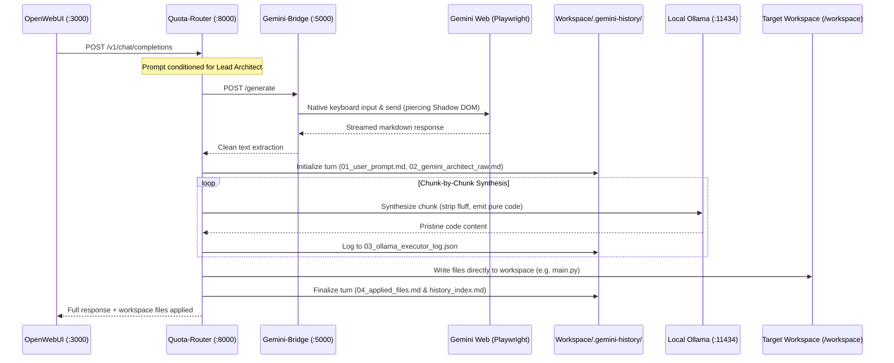

# ZeroGravity (`0g`)

> **Zero-Token Autonomous Code Generation Pipeline** bridging Headless Gemini Web with Local Ollama Code Synthesis and Direct Workspace Patching.

ZeroGravity (`0g`) turns Google's free Gemini Web interface into a high-capacity, autonomous code generation backend. By pairing Gemini as a **Lead Architect** with a local **Ollama** model as a **Code Executor & Compiler**, ZeroGravity produces clean, production-ready source code files written directly to your workspace.

---

## 🏛️ Two-Tier Architecture



### 1. Gemini Web: The Lead Architect
* Prompted with explicit awareness that its instructions and code blocks are being consumed by an automated local AI executor.
* Outputs high-level architectural designs, full file implementations, and shell execution commands.

### 2. Local Ollama: The Code Compiler & Executor
* Ingests each code section/chunk from Gemini's output.
* Uses `qwen2.5-coder:1.5b` to strip conversational fluff, markdown backticks, and introductory commentary.
* Outputs pristine, compilable code ready to write directly to disk.
* Failsafe: If Ollama is offline or times out, a deterministic regex parser guarantees valid code blocks are never lost.

### 3. OpenWebUI Internal Interceptor
* Filters out OpenWebUI's automatic background meta-prompts (tag generation, follow-up suggestions, chat titles) and answers them in `<1ms`, preventing background tasks from triggering generation or modifying workspace files.

### 4. Polyglot Language & Framework Support
ZeroGravity natively parses, validates, and routes multi-language projects:
* **Java & Spring Boot**: Automatic package-to-path resolution (`package com.example.demo...` automatically maps to `src/main/java/com/example/demo/<Class>.java` and `src/test/java/...` for `@Test` classes), Maven `pom.xml`, Gradle `build.gradle`, Spring annotations preservation (`@RestController`, `@Service`, `@Entity`, etc.).
* **TypeScript & JavaScript**: Full support for Node.js, Express, React, Next.js, and Vite projects (`package.json`, `tsconfig.json`, `*.ts`, `*.tsx`, `*.js`, `*.jsx`), ES modules, and Jest/Vitest runners.
* **Configuration & Data Formats**: Native syntax validation for `application.yaml` (PyYAML), `package.json` (JSON parser), and `pom.xml` (XML ElementTree), passing data files directly without unwanted code wrappers.
* **Python**: Full support for FastAPI, Flask, Django, Pytest, and CLI scripts with AST syntax validation.

---

## 📂 Audit Telemetry & History (`.gemini-history/`)

Every interaction is archived in `target-app/.gemini-history/` for complete auditability:

```text
.gemini-history/
├── history_index.md             <-- Human-readable overview table of all turns
├── history_index.json           <-- Machine-readable JSON telemetry array
└── turns/
    └── turn_001_20260913_184145/
        ├── 01_user_prompt.md            <-- Exact user prompt from OpenWebUI
        ├── 02_gemini_architect_raw.md   <-- Raw clean text from Gemini Web
        ├── 03_ollama_executor_log.json  <-- Chunk-by-chunk Ollama inputs & outputs
        └── 04_applied_files.md          <-- Summary of created/updated files on disk
```

### Telemetry Index Table Example (`history_index.md`):

| Turn | Timestamp | Prompt Summary | Raw Chars | Ollama Chunks | Files Written | Details |
| :--- | :--- | :--- | :--- | :--- | :--- | :--- |
| `turn_001_20260913_184145` | 20260913_184145 | _Create a file main.py with a Python script..._ | 491 | 1 | `main.py` | [View Turn](turns/turn_001_20260913_184145/) |

---

## 🚀 Quickstart

### 1. Prerequisites
* [Docker Desktop](https://www.docker.com/) with Docker Compose.
* Google account logged into Chrome profile or pre-authenticated in `~/.zerogravity-profile`.

### 2. Environment Setup
Copy the example environment file:
```bash
cp .env.example .env
```

Configure your target workspace path in `.env`:
```env
WORKSPACE_PATH=../target-app
ZEROGRAVITY_HEADLESS=true
OLLAMA_MODEL=qwen2.5-coder:1.5b
```

### 3. Start the Stack
```bash
docker compose up -d
```

Services started:
* **`gemini-bridge`**: Headless Playwright browser automation on port `5000`.
* **`quota-router`**: FastAPI router & two-tier orchestration engine on port `8000`.
* **`ollama`**: Local code synthesis model server on port `11434`.
* **`open-webui`**: Web chat interface on `http://localhost:3000`.

### 4. Authenticate Gemini Web (One-time)
If your profile directory (`~/.zerogravity-profile`) is not yet authenticated:
1. Temporarily set `ZEROGRAVITY_HEADLESS=false` in `.env`.
2. Restart the bridge: `docker compose up -d gemini-bridge`.
3. Complete the Google Sign-In manually in the launched browser window.
4. Set `ZEROGRAVITY_HEADLESS=true` and restart.

---

## 💬 Usage via OpenWebUI

1. Open **`http://localhost:3000`** in your browser.
2. Select the model **`zerogravity`** (or **`0g`**).
3. Send any prompt, for example:
   ```text
   Create a file main.py with a Python script that calculates and prints the first 10 Fibonacci numbers and prints a success message "Hello from ZeroGravity!".
   ```
4. Check your target workspace (`target-app/`):
   * `main.py` is written directly to disk.
   * `.gemini-history/` logs the full conversation, Gemini's response, and Ollama's code synthesis.

---

## 🛡️ Security & Sandbox Enforcements

* **Path Traversal Shield:** Strict boundary validation blocks any paths attempting to escape `/workspace` (e.g. `../../etc/passwd`, host drive letters).
* **Command Safety Blacklist:** Blocks dangerous commands matching patterns like `rm -rf /`, `mkfs`, fork bombs, and system reboots.
* **Overlay Interceptor Dismissal:** Automatically dismisses cookie consent, terms, and dialog overlays in Gemini Web.
* **Native Shadow DOM Penetration:** Uses Playwright's native locators to reliably extract model responses across Shadow DOM boundaries.

---

## 📁 Repository Structure

```text
0g/
├── docker-compose.yml              # Multi-container orchestration
├── .env.example                    # Configuration template
├── services/
│   ├── browser_bridge/             # Headless Gemini Web automation
│   │   ├── gemini_automator.py     # Playwright automation & shadow DOM locators
│   │   ├── server.py               # FastAPI bridge server
│   │   └── Dockerfile
│   └── router/                     # Two-tier router & synthesis engine
│       ├── src/
│       │   ├── app.py              # OpenAI-compatible API & OpenWebUI interceptor
│       │   ├── browser_extractor.py# Chunking, Ollama synthesis & regex fallback
│       │   ├── history_manager.py  # .gemini-history turn logger & indexer
│       │   └── mcp_workspace.py    # Sandbox disk write & command execution
│       ├── tests/
│       │   └── test_browser_extractor.py
│       └── Dockerfile
```
